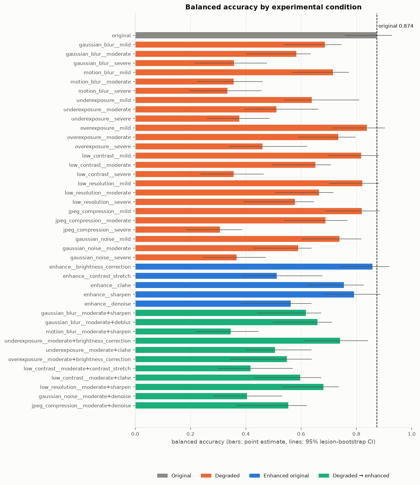
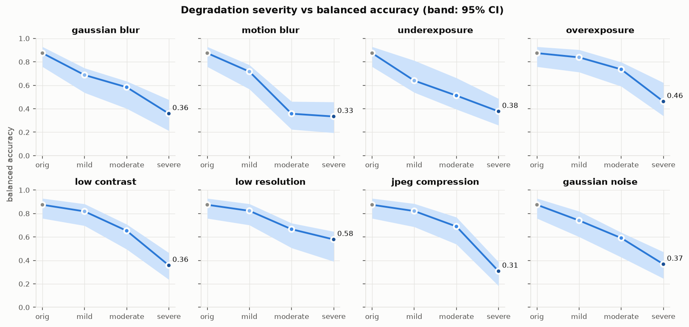
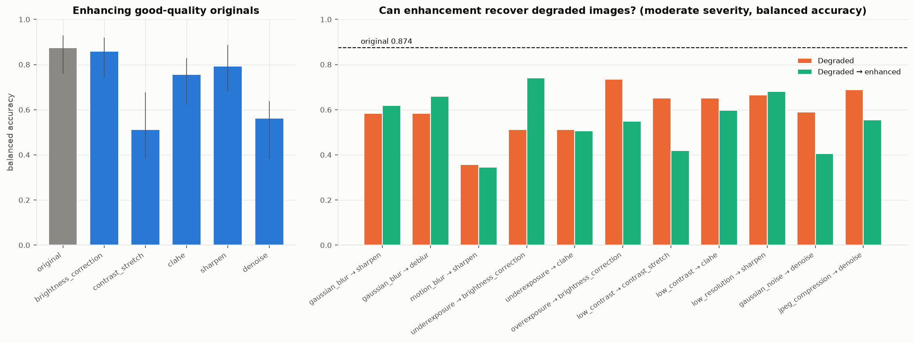

# AI Skin: Image Quality vs. Classifier Performance

An educational research system that asks:

> **Does improving the quality of skin lesion images improve the classification accuracy and reliability
> of an existing pretrained AI model?**

It takes held-out dermoscopic images, applies **controlled degradations** (blur, poor lighting,
overexposure, low contrast, low resolution, JPEG, noise) and **classical enhancements** (brightness
correction, contrast stretch, CLAHE, sharpening, denoising, deblurring), runs a **verified pretrained
skin lesion classifier** on every version, and measures how accuracy, calibration and prediction
stability change, with confidence intervals and paired statistical tests.

> ⚠️ Research and education only. Not a medical device. Do not use for diagnosis.

No model is trained here. The classifier is
[`adeIaide/skin-lesion-7class-efficientnet`](https://huggingface.co/adeIaide/skin-lesion-7class-efficientnet)
(EfficientNet-B0, 16 MB, 7 ISIC 2018 classes, CC-BY-NC-4.0), and the default evaluation data is the
**ISIC 2018 Task 3 Validation set** (193 images), which the model never saw during training.

---

## Contents

- [Requirements](#requirements)
- [Installation](#installation)
- [Quick start](#quick-start)
- [Dataset setup](#dataset-setup)
- [Model setup](#model-setup)
- [Commands](#commands)
- [Example output](#example-output)
- [Project structure](#project-structure)
- [Configuration](#configuration)
- [Troubleshooting](#troubleshooting)
- [Documentation](#documentation)

## Requirements

| | Minimum | Tested |
|---|---|---|
| OS | Linux, macOS or WSL2 | Ubuntu 24.04 on WSL2 |
| CPU | any x86-64 / ARM64 | 6 cores |
| RAM | 2 GB free | ~0.8 GB peak used |
| GPU | not needed | none |
| Disk | ~2 GB (env) + ~1 GB (data and outputs) | |
| Tools | [`uv`](https://docs.astral.sh/uv/), git | uv 0.12, git 2.43 |

`uv` installs Python 3.11 itself if needed.

## Installation

```bash
git clone git@github.com:byashwanthreddy9036-ux/AI-Skin.git
cd AI-Skin
uv sync                              # creates .venv with Python 3.11 and the pinned packages (CPU-only torch)
uv run skin-research doctor          # environment check
```

`uv sync` installs exactly the versions in `uv.lock`: PyTorch 2.15 (CPU build, so no ~2 GB CUDA download),
torchvision, OpenCV (headless), Pillow, NumPy, pandas, scikit-learn, SciPy, Matplotlib, PyYAML,
safetensors, huggingface-hub, tabulate, and pytest for development.

Every command can be run as `uv run skin-research <command>` or, inside the activated venv
(`source .venv/bin/activate`), as `python -m skin_research.cli <command>`.

## Quick start

Reproduce the whole experiment (≈70 MB download, ≈15–20 min on a 6-core CPU):

```bash
uv run skin-research download-data                     # ISIC 2018 Validation, 53 MB, official ISIC bucket
uv run skin-research prepare-data --fetch-lesion-ids   # canonical CSV + lesion ids from the ISIC API
uv run skin-research validate-data                     # missing/corrupt files, labels, duplicates
uv run skin-research download-model                    # 16 MB, verifies architecture and label mapping
uv run skin-research demo --image-id ISIC_0034329      # first milestone: 1 image, 5 versions, predictions
uv run skin-research experiment                        # 193 images × 41 conditions → metrics, charts, report
uv run pytest                                          # 72 tests incl. a real end-to-end smoke test
```

The report is written to `outputs/reports/isic2018_val_quality/report.md`.

For a fast trial run first: `uv run skin-research experiment --max-images 20 --conditions gaussian_blur underexposure enhance__clahe`.

## Dataset setup

### Default: ISIC 2018 Task 3 Validation (automatic)

`download-data` fetches the images and ground truth from `https://isic-archive.s3.amazonaws.com/challenges/2018/`
into `data/raw/isic2018_val/`. `prepare-data` converts the one-hot ground truth into the canonical CSV
`data/processed/isic2018_val_metadata.csv`; `--fetch-lesion-ids` adds `lesion_id` per image from the
public ISIC Archive API so that the bootstrap and any splits are **lesion-level**. Patient IDs are not
public, so patient-level independence cannot be guaranteed (this is stated in every report).

```bash
uv run skin-research download-data --list    # available datasets and sizes
```

| Key | Images | Size | Notes |
|---|---|---|---|
| `isic2018_val` | 193 | 51 MB | default, held out from the model's training data |
| `isic2018_test` | 1,512 | 401 MB | held out; asks for confirmation (>100 MB) |
| `isic2018_train` | 10,015 | 2.6 GB | = HAM10000; **the model was trained on it** (leakage warning) |

To use the Test set:

```bash
uv run skin-research download-data --dataset isic2018_test
uv run skin-research prepare-data --dataset isic2018_test --fetch-lesion-ids \
    --output data/processed/isic2018_test_metadata.csv
```

then edit `configs/config.yaml`:

```yaml
dataset:
  name: isic2018_test
  metadata_csv: data/processed/isic2018_test_metadata.csv
  image_root: data/raw/isic2018_test/ISIC2018_Task3_Test_Input
experiment:
  name: isic2018_test_quality
```

### HAM10000 from Harvard Dataverse / Kaggle

Place images in `data/raw/ham10000/images/` and run
`uv run skin-research prepare-data --ham10000-metadata data/raw/ham10000/HAM10000_metadata.csv --output data/processed/ham10000_metadata.csv`,
then point `dataset.metadata_csv` / `dataset.image_root` at them. Remember the leakage caveat above.

### Your own images

Create a CSV:

```csv
image_path,label,lesion_id,patient_id
patient7/lesion_a.jpg,mel,L001,P007
patient7/lesion_a_2.jpg,mel,L001,P007
img_0003.png,nv,,
```

`image_path` is relative to `dataset.image_root` (or absolute); `label` must be one of
`akiec, bcc, bkl, df, mel, nv, vasc`; `lesion_id`/`patient_id` are optional but enable leakage-free
grouping. Then run `validate-data`.

**Original images are never modified.** Generated images go to `data/variations/<experiment>/<condition>/`
and the code refuses to overwrite existing files.

## Model setup

`download-model` downloads `config.json` and `model.safetensors` from the Hugging Face Hub at a
**pinned commit** into `models/` (git-ignored), rebuilds the published architecture, loads the weights
with `strict=True` and checks the label mapping. After that everything works offline
(`HF_HUB_OFFLINE=1`). If the download fails you get an explicit error; the system never produces
placeholder predictions. Details and the label mapping are in
[`docs/MODEL_AND_DATASET.md`](docs/MODEL_AND_DATASET.md).

## Commands

See [`docs/CHEATSHEET.md`](docs/CHEATSHEET.md) for real example output of every command, test commands and common errors.

| Command | What it does |
|---|---|
| `doctor` | Python, packages, CPU/RAM/disk, CUDA, data and model availability |
| `download-data [--dataset KEY] [--list] [-y]` | Download a registered ISIC dataset (asks above 100 MB) |
| `prepare-data [--dataset KEY] [--fetch-lesion-ids] [--ham10000-metadata CSV]` | Build the canonical metadata CSV |
| `validate-data` | Missing files, corrupt images, unknown labels, duplicate ids, exact (SHA-256) and near (dHash) duplicates |
| `dataset-info` | Class distribution, imbalance, lesion counts, split level |
| `assess-quality [IMAGES/FOLDERS...]` | Brightness, contrast, Laplacian blur, Tenengrad sharpness, noise, clipping → CSV + Markdown report |
| `generate-variations [--max-images N] [--conditions ...] [--force]` | Degraded/enhanced images + traceability manifest |
| `download-model` | Download and verify the pretrained classifier |
| `predict [IMAGES...]` | Predict given images, or every image in the manifest |
| `experiment [--max-images N] [--conditions ...] [--batch-size B]` | Full pipeline: split → variations → inference → evaluation → charts → report |
| `evaluate` | Recompute metrics, CIs, paired tests and charts from saved predictions |
| `report` | Regenerate the Markdown report |
| `demo [--image PATH --label L \| --image-id ID]` | Milestone demo on one image (original, blur, dark, sharpened, CLAHE) |

Global options: `--config PATH`, `--log-level DEBUG`. Conditions accept exact names
(`gaussian_blur__moderate`) or prefixes (`gaussian_blur`, `enhance__`); `original` is always included.

## Example output

Results of `skin-research experiment` on the ISIC 2018 Validation set (193 images from 145 lesions,
41 conditions, 7,913 real CPU inferences in 29 min at 8.6 img/s). Full report:
`outputs/reports/isic2018_val_quality/report.md`.

**First milestone (`demo --image-id ISIC_0034329`, a melanoma):**

```
               version  brightness  rms_contrast  laplacian_var predicted_label  confidence
              original       0.740         0.183       1136.793             mel       0.895
gaussian_blur_moderate       0.740         0.179         13.665              nv       0.376
poor_lighting_moderate       0.393         0.126        567.198             mel       0.760
             sharpened       0.740         0.186       3832.022             mel       0.855
                 clahe       0.694         0.175       3885.031             mel       0.847
```

**Selected results** (balanced accuracy with 95% lesion-bootstrap CI; Δ vs original is paired):

| Condition | Accuracy | Balanced acc. [95% CI] | Melanoma sensitivity |
|---|---|---|---|
| original | 0.870 | 0.874 [0.758, 0.929] | 0.76 |
| gaussian_blur mild / severe | 0.762 / 0.642 | 0.688 / 0.359 | 0.14 / 0.00 |
| underexposure mild / severe | 0.813 / 0.668 | 0.640 / 0.378 | 0.81 / 0.24 |
| jpeg_compression severe | 0.653 | 0.308 | 0.14 |
| enhance: brightness_correction | 0.829 | 0.860 (Δ −0.015, CI includes 0) | 0.86 |
| enhance: CLAHE | 0.756 | 0.756 (Δ −0.118, CI below 0) | 0.67 |
| enhance: denoise | 0.591 | 0.563 (Δ −0.311, CI below 0) | 0.10 |
| underexposure moderate → brightness_correction | 0.808 | 0.742 (vs 0.512 degraded, CI above 0) | 0.67 |

What the data shows for this model and sample (details and caveats in the report):

1. **Degradation hurts, monotonically.** All 8 degradation types reduce balanced accuracy as severity
   increases; 36 of 40 conditions are lower than original with a CI excluding 0.
2. **Enhancing already-good images never helped.** No transformation beat the original; CLAHE, contrast
   stretching and denoising made it significantly worse. The model expects images like its training data.
3. **Targeted restoration can partly help.** Brightness correction recovered 63% of the balanced accuracy
   lost to underexposure, and deblurring 26% of the loss to blur. Mismatched "fixes" (contrast stretch on
   low-contrast, denoise on JPEG) made things worse.
4. **Melanoma is the most fragile class.** Even mild blur cut melanoma sensitivity from 0.76 to 0.14; most
   missed melanomas were predicted as benign nevi.
5. **Confidence is a weak warning signal.** The model is under-confident (58% mean confidence at 87%
   accuracy), and correct and wrong predictions have nearly identical confidence under degradation.
6. **Simple quality metrics miss damaging problems.** The heuristic flags did not catch noise, JPEG or some
   blur conditions that cut accuracy sharply (noise even *raises* the Laplacian "sharpness" score).

With only 1 dermatofibroma and 3 vascular images, macro metrics swing by 0.143 per rare-class image; the
larger ISIC Test set (1,512 images) would give much tighter estimates.






## Project structure

```
AI-Skin/
├── configs/config.yaml          # every parameter: seed, model revision, severities, enhancements, conditions
├── data/{raw,processed,variations,sample}/   # git-ignored data (originals are read-only)
├── models/                      # git-ignored weight cache
├── src/skin_research/
│   ├── cli.py  config.py  experiment.py  pipeline.py
│   ├── data/          download.py  metadata.py  loader.py  validation.py
│   ├── quality/       metrics.py  assessment.py
│   ├── preprocessing/ degradation.py  enhancement.py  variations.py
│   ├── inference/     model_loader.py  predictor.py
│   ├── evaluation/    metrics.py  comparison.py
│   ├── reporting/     charts.py  report.py
│   └── utils/         logging.py  reproducibility.py
├── outputs/{predictions,charts,reports,logs}/   # git-ignored results
├── tests/                       # 72 tests (unit + real end-to-end)
└── docs/                        # ARCHITECTURE, EXPERIMENT_METHODOLOGY, MODEL_AND_DATASET
```

Per experiment the outputs are:

| Path | Content |
|---|---|
| `outputs/predictions/<exp>/predictions.csv` | one row per image × condition: probabilities, prediction, confidence, quality metrics, recipe |
| `outputs/predictions/<exp>/run_info.json` | dataset stats, model metadata and weights hash, environment, timings |
| `outputs/predictions/<exp>/config_used.yaml` | exact configuration of the run |
| `data/variations/<exp>/manifest.csv` | traceability: source image → transform → parameters → output file |
| `outputs/reports/<exp>/metrics_*.csv`, `metrics.json` | summary, per-class, paired comparisons, restoration, severity |
| `outputs/charts/<exp>/*.png` | overview, severity, enhancement, class-wise, confidence, calibration, confusion, example |
| `outputs/reports/<exp>/report.md` | the research report |

## Configuration

Everything is in [`configs/config.yaml`](configs/config.yaml). Common edits:

- `model.batch_size` / `model.num_threads`: on 6-core WSL2, batch 8 with 3 threads was fastest; more
  threads were slower.
- `experiment.save_images: false`: generate variants in memory only (saves ~0.5 GB per 193 images;
  the manifest still records every recipe, and images are reproducible from the seed).
- `degradations.*` / `enhancements.*`: severity parameters. Changing them for an existing experiment
  requires `--force` (or a new `experiment.name`) so results are never mixed.
- `dataset.max_images`: quick runs with a stratified, lesion-aware subset.

## Troubleshooting

| Problem | Fix |
|---|---|
| `Metadata CSV not found` | Run `download-data` then `prepare-data` |
| `Could not obtain 'model.safetensors'` | Check internet; retry `download-model`; behind a proxy set `HTTPS_PROXY` |
| `... was generated with different parameters` | You changed a severity/enhancement; rerun with `--force` or set a new `experiment.name` |
| Slow inference | Lower `model.num_threads` (WSL2 favours 2–3), keep `batch_size` at 4–8, close heavy Windows apps |
| `Refusing to compute metrics — label mapping incompatible` | Your model's classes do not map 1:1 to the dataset labels; edit `model.label_map` |
| Out of memory | Reduce `model.batch_size`; images are already streamed one at a time |
| `python: command not found` / wrong Python | Use `uv run ...`, which always uses the project's Python 3.11 |
| Tests show `skipped` | The real-model/real-data tests need `download-data`, `prepare-data` and `download-model` first |

## Documentation

- [`docs/CHEATSHEET.md`](docs/CHEATSHEET.md): every command and test command, when to use it, real example output, errors and fixes
- [`docs/ARCHITECTURE.md`](docs/ARCHITECTURE.md): modules, data flow, model adapter, model selection
- [`docs/EXPERIMENT_METHODOLOGY.md`](docs/EXPERIMENT_METHODOLOGY.md): hypotheses, conditions, statistics, reproducibility
- [`docs/MODEL_AND_DATASET.md`](docs/MODEL_AND_DATASET.md): sources, label mapping, licences, limitations

## Licences

Code: MIT. Model weights: CC-BY-NC-4.0. ISIC 2018 / HAM10000 images: CC-BY-NC (Tschandl et al. 2018;
Codella et al. 2019). Data and weights are downloaded by the user and never committed here.
